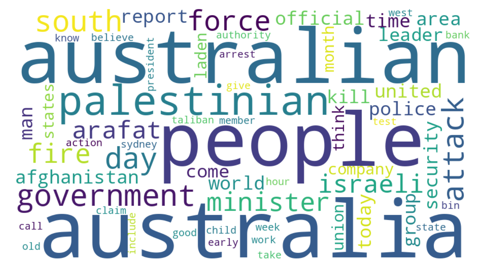

# CorpusCreation: Text Corpus Builder and Analyzer

Python pipeline that builds a text corpus (from local `.txt` files or by scraping a website) and analyses it: lemmatization with spaCy, word frequencies, named entities, sentiment, and **LDA topic modelling with the number of topics chosen by coherence (c_v)**. It writes a corpus-quality report, a word cloud and a topic table.



## Demo results

Run on the *Lee* news corpus (300 short Australian news articles, English) that ships with gensim:

| Corpus statistic | Value |
|---|---|
| Documents | 300 |
| Tokens (after lemmatization and filtering) | 29,388 |
| Vocabulary | 5,268 |
| Median tokens per document | 81 |
| Mean sentiment polarity / subjectivity (TextBlob) | 0.061 / 0.373 |

Topic count was chosen by c_v coherence over k = 3…8 (best: **k = 3, c_v = 0.46**; k = 8 gives 0.43):

| Topic | Top words | Reading |
|---|---|---|
| 1 | palestinian israeli arafat attack official israel leader people | Israeli–Palestinian conflict |
| 2 | australia australian south government day fire people company | Australian domestic news (bushfires, economy) |
| 3 | afghanistan force day people bin laden government united | Afghanistan war |

Coherence differences between k values are small, so treat the topic count as indicative, not definitive. The notebook [`notebooks/exploratory_analysis.ipynb`](notebooks/exploratory_analysis.ipynb) repeats the analysis with a wider range (k = 2…10) and slightly different stopwords, where coherence peaks at k = 8 (c_v = 0.45): a different setting, which shows how sensitive the choice is.

## Features

- **Two sources:** a folder of `.txt` files, or web scraping with `robots.txt` checks, a delay between requests and a custom User-Agent.
- **Preprocessing:** URL removal, spaCy lemmatization, part-of-speech filter (nouns, proper nouns, verbs, adjectives, adverbs), custom stopwords, minimum document length.
- **Analysis:** top words, type/token ratio, sentiment, named entities, LDA with automatic topic-count selection.
- **Outputs** (`outputs/`): `report.json`, `top_words.csv`, `topics.csv`, `wordcloud.png`, and optionally `corpus.jsonl`.
- **Tests:** `pytest` suite for extraction, preprocessing and analysis.

## Quick start

```bash
git clone https://github.com/Nicolakorff/CorpusCreation.git
cd CorpusCreation
python -m venv .venv && source .venv/bin/activate   # Windows: .venv\Scripts\activate
pip install -r requirements.txt
python -m spacy download en_core_web_sm

python scripts/prepare_lee_corpus.py                 # demo corpus -> data/lee_demo/
python main.py --config config.example.json
pytest
```

## Configuration

`config.example.json` overrides the defaults in `corpus_tool/config.py`.

```json
{
  "source": {"type": "dir", "path": "data/lee_demo"},
  "preprocessing": {"extra_stopwords": ["say", "tell", "year", "new"], "min_doc_tokens": 30},
  "analysis": {"topics": {"min": 3, "max": 8}},
  "output_dir": "outputs"
}
```

To scrape instead, set `"source": {"type": "web", "url": "https://…", "article_link_selector": "…", "title_selector": "h1", "content_selector": "article p", "max_articles": 50}`. CSS selectors are site-specific. Only scrape sites whose terms allow it, and prefer openly licensed sources: the repository does **not** store scraped article text (`save_corpus_text` is off by default).

## Repository structure

```
├── main.py                  # command-line entry point
├── config.example.json
├── corpus_tool/
│   ├── config.py            # defaults + JSON override
│   ├── extractor.py         # local files / polite scraping
│   ├── preprocessor.py      # cleaning, lemmatization, stopwords
│   └── analyzer.py          # statistics, sentiment, entities, LDA, word cloud
├── scripts/prepare_lee_corpus.py
├── tests/
├── notebooks/exploratory_analysis.ipynb   # executed walkthrough with plots
└── docs/                    # demo word cloud and topics
```

## Limitations

- **English only** (spaCy `en_core_web_sm`, TextBlob). Other languages need another spaCy model and a different sentiment method.
- TextBlob is lexicon-based and crude; it is a baseline, not a validated sentiment model.
- LDA is sensitive to preprocessing and random seed (fixed here at 42); coherence is a heuristic, not ground truth.
- Scraping selectors break when a site changes its HTML.
- No manual annotation or evaluation against labelled data.

## Next steps

- Multilingual support (German, Spanish, Catalan spaCy models) and language detection.
- Compare LDA with embedding-based topic models (e.g. BERTopic).
- Evaluate sentiment against a labelled dataset.

## Author

**Nicola Korff** · [LinkedIn](https://www.linkedin.com/in/nicola-korff/) · [GitHub](https://github.com/Nicolakorff)
